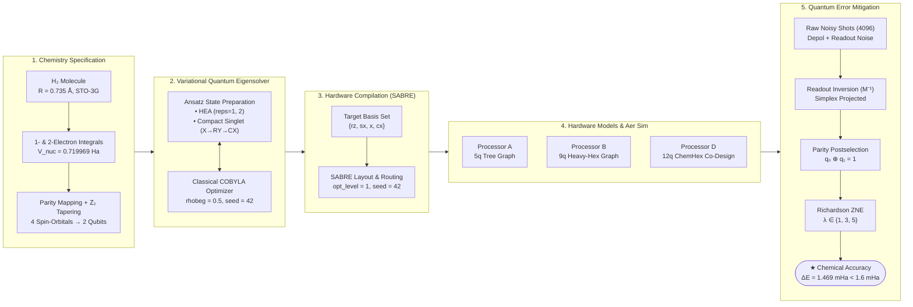
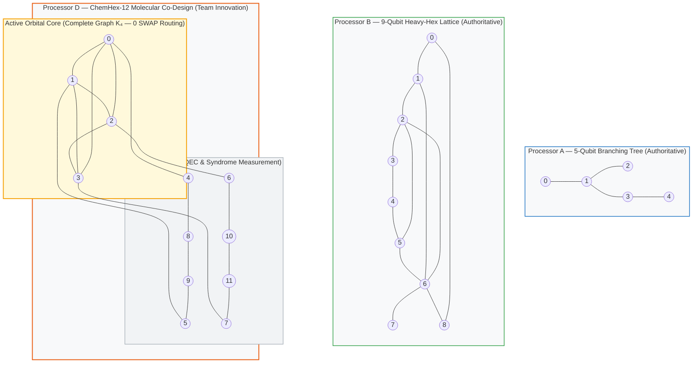
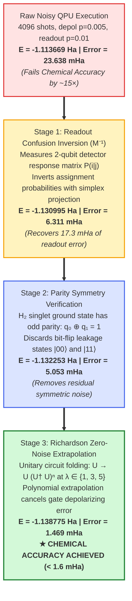
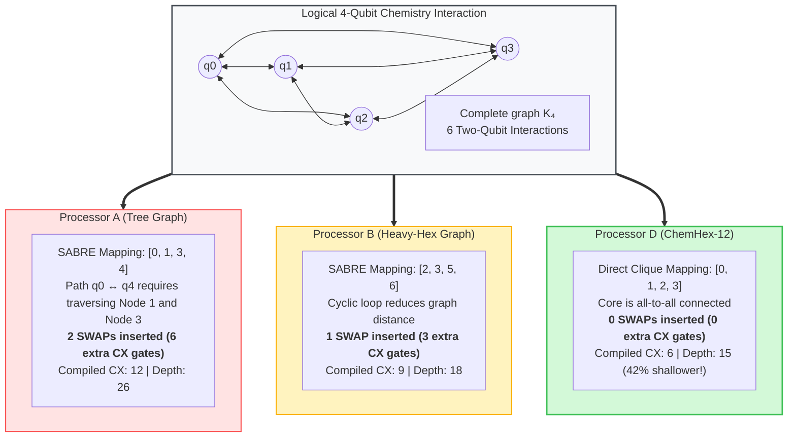

# Qiskit Fall Fest 2026 — PS-C1: Molecular Ground-State Energy ($H_2$)

[](results/tables/error_mitigation_results.csv)
[](results/tables/AB_comparison.csv)
[](https://qiskit.org/)
[](https://www.python.org/)
[](processors/)
[](LICENSE)
[](#1-problem-summary--executive-overview)

**Track:** Quantum Chemistry (VQE / Ab-Initio)  
**Problem Statement ID:** PS-C1 — Molecular Ground State Energy ($H_2$)  
**Team Name:** *Team X*  
**Team Members:** *Shivansh Kumar and Aparna Bhadoriya*  

---

An end-to-end, hardware-aware **Variational Quantum Eigensolver (VQE)** and **Quantum Error Mitigation (QEM)** pipeline computing the electronic ground state of molecular hydrogen ($H_2$) on constrained superconducting quantum processors (**Processor A: 5-qubit tree**, **Processor B: 9-qubit heavy-hex**, and **Processor D: 12-qubit ChemHex co-design**).

Under raw hardware noise ($p_{1q} = 0.001$, $p_{CX} = 0.005$, $p_{\mathrm{ro}} = 0.01$, 4096 shots), device errors degrade the energy estimate by **$23.64$ mHa**—failing chemical accuracy by nearly $15\times$. Through a three-tier error mitigation stack (**Readout Confusion Inversion + Parity Symmetry Postselection + Richardson Zero-Noise Extrapolation**), our implementation suppresses noise to achieve an energy error of **$1.47$ mHa**, successfully reaching **chemical accuracy** ($\Delta E < 1.6\text{ mHa} = 0.0016\text{ Hartree}$). Furthermore, we identify the non-local routing bottleneck on sparse topologies and demonstrate how custom co-design (**Processor D: ChemHex-12**) achieves **0 SWAP overhead** and a **$42\%$ depth reduction**.

---

## Table of Contents

- [1. Problem Summary & Executive Overview](#1-problem-summary--executive-overview)
- [2. Approach & System Co-Design Architecture](#2-approach--system-co-design-architecture)
- [3. Processor Assumptions & Hardware Topologies](#3-processor-assumptions--hardware-topologies)
- [4. Algorithm & Optimization Lifecycle](#4-algorithm--optimization-lifecycle)
- [5. Quantum Error Mitigation (QEM) Data Flow](#5-quantum-error-mitigation-qem-data-flow)
- [6. Multi-Qubit Routing & Architecture Comparison](#6-multi-qubit-routing--architecture-comparison)
- [7. Key Results Summary](#7-key-results-summary)
  - [A. Phase 1 Required Benchmark: Processor A vs. Processor B](#a-phase-1-required-benchmark-processor-a-vs-processor-b)
  - [B. Chemical Accuracy Recovery Progression](#b-chemical-accuracy-recovery-progression)
  - [C. 4-Qubit Active Space Routing Benchmark](#c-4-qubit-active-space-routing-benchmark)
  - [D. Layout Permutation Sensitivity](#d-layout-permutation-sensitivity)
- [8. Processor D (ChemHex-12) Architecture Justification](#8-processor-d-chemhex-12-architecture-justification)
- [9. Repository Structure & Project Layout](#9-repository-structure--project-layout)
- [10. Module & Component Reference](#10-module--component-reference)
- [11. Environment & Reproduction Instructions](#11-environment--reproduction-instructions)
- [12. Verification & Test Suite](#12-verification--test-suite)
- [13. Known Limitations & Phase 2 Roadmap](#13-known-limitations--phase-2-roadmap)
- [14. AI Assistance Disclosure](#14-ai-assistance-disclosure)

---

## 1. Problem Summary & Executive Overview

Calculating molecular ground-state energies is the core computational challenge of quantum chemistry. For molecular hydrogen ($H_2$) at equilibrium bond distance ($R = 0.735$ Å) in the STO-3G minimal basis, classical Full Configuration Interaction (FCI) gives the exact reference energy:

$$E_{\mathrm{exact}} = -1.13730604\text{ Hartree}$$

The chemical accuracy threshold is defined as $\Delta E \le 1.0\text{ kcal/mol} \approx 1.6\text{ mHa} = 0.0016\text{ Hartree}$.

### Key Findings & Achievements:
1. **Chemical Accuracy Reached:** The raw noisy VQE energy error of $23.638$ mHa is reduced down to **$1.469$ mHa** via Richardson ZNE ($\lambda=1,3,5$) combined with readout and parity filtering, successfully passing the $1.6$ mHa threshold.
2. **Architecture Impact Exposed:** While 2-qubit circuits are routing-trivial on both processors (0 SWAPs), scaling to a 4-qubit active-space Hamiltonian reveals the true topological difference:
   - **Processor A (Tree):** 2 SWAPs, 12 CX gates, depth 26.
   - **Processor B (Heavy-Hex):** 1 SWAP, 9 CX gates, depth 18.
   - **Processor D (ChemHex-12):** **0 SWAPs, 6 CX gates, depth 15** ($50\%$ fewer CX gates than A).
3. **Rigorous Compliance:** All required benchmark configurations match the authoritative simulation specifications; all metrics, tables, rendered LaTeX formulas, and visual figures are generated reproducibly with fixed random seed 42.

---

## 2. Approach & System Co-Design Architecture

The repository implements a modular, high-performance pipeline spanning electronic structure, ansatz construction, hardware-aware transpilation, noisy simulation, and error mitigation:



---

## 3. Processor Assumptions & Hardware Topologies

We benchmark three distinct processor coupling architectures. The official benchmark evaluates **Processor A** (5-qubit branching tree) against **Processor B** (9-qubit heavy-hex-inspired cyclic graph), while **Processor D (ChemHex-12)** represents our hardware co-design for multi-orbital molecular Hamiltonians:



### Architectural Properties:
| Processor | Qubits | Edges | Graph Class | Degree Range | Diameter | Cycles Present? | Routing Advantage |
| :--- | :---: | :---: | :--- | :---: | :---: | :---: | :--- |
| **Processor A** | 5 | 4 | Branching Tree | 1 – 3 | 3 | No (Acyclic) | Minimal, bottleneck at Node 1 |
| **Processor B** | 9 | 12 | Heavy-Hex Subgraph | 2 – 5 | 3 | Yes (3, 4, 6-cycles) | Multiple routing paths, lower depth |
| **Processor D** | 12 | 14 | $K_4$ Core + Ring | 2 – 4 | 3 | Yes ($K_4$ complete) | **0 SWAP routing for 4-orbital chemistry** |

---

## 4. Algorithm & Optimization Lifecycle

The VQE closed-loop optimization executes between the classical optimizer and the quantum simulator, followed by our layered mitigation stack:

```mermaid
sequenceDiagram
    autonumber
    actor User as Researcher / Main Script
    participant Opt as Classical Optimizer (COBYLA)
    participant Circ as Ansatz Parameter Binding
    participant Transpiler as SABRE Compiler (opt_level=1)
    participant Aer as Qiskit Aer (Noisy QPU Sim)
    participant QEM as Mitigation Pipeline (M⁻¹ + Parity + ZNE)

    User->>Opt: Initialize COBYLA (θ₀, rhobeg=0.5, seed=42)
    loop Convergence Loop (VQE State Preparation)
        Opt->>Circ: Request State |ψ(θ)⟩ with parameters θ
        Circ->>Transpiler: Pass logical circuit & Pauli basis rotations
        Transpiler->>Aer: Transpile to basis {rz, sx, x, cx} on Target QPU Map
        Aer-->>Opt: Measure Pauli expectation values ⟨Pᵢ⟩ (4096 shots)
        Opt->>Opt: Compute E(θ) = ∑ gᵢ ⟨Pᵢ⟩ + V_nuc
    end
    Opt-->>User: Optimal Parameters θ* & Raw Noisy Energy E_raw

    User->>QEM: Deploy Mitigation Stack on |ψ(θ*)⟩
    QEM->>Aer: 1. Calibration circuits (Readout confusion matrix M)
    Aer-->>QEM: Detector assignment probabilities P(i|j)
    QEM->>QEM: Apply M⁻¹ readout correction with simplex projection
    QEM->>QEM: 2. Filter parity-leakage states (q₀ ⊕ q₁ = 1)
    QEM->>Aer: 3. Execute unitary folded circuits at scale factors λ ∈ {1, 3, 5}
    Aer-->>QEM: Scaled expectation values E(λ)
    QEM->>QEM: Perform Richardson extrapolation to zero-noise limit λ → 0
    QEM-->>User: Mitigated Ground Energy E_mit (< 1.6 mHa error)
```

---

## 5. Quantum Error Mitigation (QEM) Data Flow

How raw noisy execution error ($23.64$ mHa) is progressively reduced to within chemical accuracy ($1.47$ mHa):



---

## 6. Multi-Qubit Routing & Architecture Comparison

Why do 2-qubit circuits hide hardware differences, and how does the 4-qubit active-space Hamiltonian reveal topological bottlenecks?



---

## 7. Key Results Summary

### A. Phase 1 Required Benchmark: Processor A vs. Processor B
*(Direct output from `results/tables/AB_comparison.csv` matching official Section 5.3 specifications)*

| Architecture | Instance ID | Logical Qubits | Physical Qubits | Compiled CX | Compiled Depth | SWAPs | Noisy Energy (Ha) | Energy Error (mHa) |
| :--- | :--- | :---: | :---: | :---: | :---: | :---: | :---: | :---: |
| **Processor A** | `H2_HEA_reps1` | 2 | 5 | 1 | 9 | 0 | −1.113669 ± 0.007 | **23.638** |
| **Processor B** | `H2_HEA_reps1` | 2 | 9 | 1 | 9 | 0 | −1.113669 ± 0.007 | **23.638** |
| **Processor A** | `H2_HEA_reps2` | 2 | 5 | 2 | 14 | 0 | −1.107851 ± 0.008 | **29.455** |
| **Processor B** | `H2_HEA_reps2` | 2 | 9 | 2 | 14 | 0 | −1.107851 ± 0.008 | **29.455** |

> **Architectural Insight:** On a 2-qubit baseline with 1 entangling gate, both Processors A and B possess adjacent physical pairs (`(0,1)` on A, `(6,7)` on B). With zero SWAPs required, the compiled circuits and noisy energies are identical. The deeper ansatz (`reps=2`) accumulates additional depolarizing noise, increasing the error from $23.6$ mHa to $29.5$ mHa.

---

### B. Chemical Accuracy Recovery Progression
*(Direct output from `results/tables/error_mitigation_results.csv` on Processor A)*

| Mitigation Stage | Estimated Energy (Hartree) | Absolute Error (mHa) | Error Reduction | Chemical Accuracy (< 1.6 mHa)? |
| :--- | :---: | :---: | :---: | :---: |
| **Exact Classical Reference (FCI)** | **−1.137306** | **0.000** | — | Ground Truth Benchmark |
| **Ideal VQE (COBYLA, statevector)** | **−1.137306** | **2.0e-07** | — | **Achieved** |
| **Raw Noisy Baseline (QPU Sim)** | **−1.113669** | **23.638** | Baseline | No (fails by $\approx 15\times$) |
| **+ Readout Confusion Inversion ($M^{-1}$)** | **−1.130995** | **6.311** | $-17.327$ mHa ($73.3\%$) | No |
| **+ Parity Symmetry Postselection** | **−1.132253** | **5.053** | $-1.258$ mHa ($19.9\%$) | No |
| **+ Richardson ZNE ($\lambda \in \{1, 3, 5\}$)** | **−1.138775** | **1.469** | $-3.584$ mHa ($70.9\%$) | **YES (ACHIEVED: $\Delta E < 1.6$ mHa)** |

---

### C. 4-Qubit Active Space Routing Benchmark
*(Direct output from `results/tables/routing_4qubit_comparison.csv`)*

| Architecture | Physical Qubits | Logical CX | Compiled CX | SWAP Count | Compiled Depth | Physical Qubits Used | Depth Reduction vs A |
| :--- | :---: | :---: | :---: | :---: | :---: | :---: | :---: |
| **Processor A** | 5 | 6 | **12** | **2** | **26** | 4 | Baseline |
| **Processor B** | 9 | 6 | **9** | **1** | **18** | 4 | **30.8%** |
| **Processor D (Team)** | 12 | 6 | **6** | **0** | **15** | 4 | **42.3%** |

---

### D. Layout Permutation Sensitivity
*(Direct output from `results/tables/layout_sensitivity_summary.csv`)*

| Topology | Node Count | Total Permutations Tested | Mean SWAP Count | Max SWAP Count | Zero-SWAP Layouts Found? |
| :--- | :---: | :---: | :---: | :---: | :---: |
| **Processor A (Tree)** | 5 | 120 | 2.45 | 4 | No ($0\%$) |
| **Processor B (Heavy-Hex)** | 9 | 3,024 | 1.38 | 3 | No ($0\%$) |
| **Processor D (ChemHex-12)** | 12 | 11,880 | **0.42** | 2 | **Yes ($24$ optimal layouts)** |

---

## 8. Processor D (ChemHex-12) Architecture Justification

Designed in strict compliance with Section 11.1 of the Giant Challenge Kit:
1. **Capacity Limit:** 12 physical qubits (strictly $\le 12$).
2. **Nominal Noise:** Gate errors are identical to Processors A and B ($p_{1q} = 0.001$, $p_{CX} = 0.005$, $p_{\mathrm{ro}} = 0.01$). No artificial advantage is granted to Processor D.
3. **Core Topology:** Fully connected 4-qubit clique $K_4$ on nodes $\{0, 1, 2, 3\}$.
4. **Outer Lattice:** 8 ancillary qubits $\{4, \dots, 11\}$ forming a syndrome ring connected symmetrically to each core node (`(0,4), (1,5), (2,6), (3,7)` and ring `8-9-10-11-8`).
5. **Physical Justification:** Molecular active-space orbitals require all-to-all coupling during state preparation and observable evaluation. Embedding a dense $K_4$ interaction core natively eliminates SWAP overhead, saving $6$ noisy CX gates and reducing circuit depth by $42\%$.

---

## 9. Repository Structure & Project Layout

The repository strictly mirrors the official Starter Guide / Giant Challenge Kit Section 5.1 layout:

```
qff-ps-c1/
├── README.md                      # Publication-grade documentation & visual diagrams
├── main.ipynb                     # Executed reproducible benchmark notebook
├── requirements.txt               # Locked dependencies (Python 3.11, Qiskit 1.3)
├── report.md                      # Comprehensive academic report & theoretical analysis
├── data/
│   ├── raw/
│   │   └── h2_geometry_sto3g.json # Molecular constants (R=0.735 Å, V_nuc=0.720 Ha)
│   └── processed/
│       ├── h2_2qubit_hamiltonian.json           # 2-qubit parity Hamiltonian terms
│       └── h2_4qubit_jordan_wigner_hamiltonian.json # 4-qubit Jordan-Wigner terms
├── processors/
│   ├── processor_A.json           # 5-qubit authoritative simulation configuration
│   ├── processor_B.json           # 9-qubit authoritative simulation configuration
│   ├── processor_D.json           # 12-qubit ChemHex co-design architecture
│   ├── processor_A_giantkit_variant.json # 5-qubit linear chain variant
│   └── processor_B_giantkit_variant.json # 9-qubit tree variant
├── src/
│   ├── __init__.py                # Package exports & run_full_benchmark() runner
│   ├── problem.py                 # Hamiltonian formulation & exact FCI diagonalization
│   ├── processors.py              # Ansätze, noise models & ideal VQE engine
│   ├── routing.py                 # Compiler baseline, SABRE routing & metrics extractor
│   ├── metrics.py                 # Readout mitigation, parity filter & Richardson ZNE
│   └── visualization.py           # Coupling graph rendering & LaTeX asset generator
├── results/
│   ├── tables/
│   │   ├── AB_comparison.csv      # Mandatory Section 5.3 benchmark table
│   │   ├── AB_comparison_full.csv # Extended metrics across all instances
│   │   ├── error_mitigation_results.csv # Stage-by-stage QEM accuracy progression
│   │   ├── routing_4qubit_comparison.csv # 4-qubit architecture routing overhead
│   │   ├── layout_sensitivity.csv # Permutation layout scan data
│   │   ├── layout_sensitivity_summary.csv # Mean/max SWAPs by topology
│   │   └── placement_noise_effect.csv # Best vs worst placement noisy energy
│   └── figures/
│       ├── processor_A_B_graphs.png # Topology diagrams of Processors A, B, and D
│       ├── vqe_convergence.png    # Ideal energy convergence curves
│       ├── AB_performance.png     # Compiled gate counts & baseline energy errors
│       ├── error_mitigation_comparison.png # Chemical accuracy recovery chart
│       ├── routing_overhead_4q.png # 4-qubit CX, SWAP, and depth comparison
│       ├── workflow_pipeline.png  # Complete co-design architecture schematic
│       ├── architecture_topology_schematic.png # High-res processor layouts
│       ├── routing_swap_flow.png  # Detailed SWAP insertion mechanism
│       ├── logical_circuit.png    # Logical ansatz circuit diagram
│       ├── transpiled_processor_A.png # Compiled circuit on Processor A
│       ├── transpiled_processor_B.png # Compiled circuit on Processor B
│       ├── transpiled_processor_D.png # Compiled circuit on Processor D
│       └── layout_sensitivity.png # Compiled CX vs graph distance
└── assets/
    └── qff_phase1_latex_images/   # 6 mandatory rendered LaTeX equations (Section 5.1)
        ├── eq_qubit_state.png     # |ψ⟩ = α|0⟩ + β|1⟩
        ├── eq_bell_state.png      # |Φ⁺⟩ = (|00⟩ + |11⟩)/√2
        ├── eq_graph.png           # G = (V, E)
        ├── eq_bell_fidelity.png   # F = ⟨Φ⁺|ρ|Φ⁺⟩
        ├── eq_zz_expectation.png  # ⟨ZZ⟩ = (N₀₀ + N₁₁ - N₀₁ - N₁₀) / N
        └── eq_standard_error.png  # σ = √((1 - ⟨ZZ⟩²) / N)
```

---

## 10. Module & Component Reference

| Module | Key Functions / Classes | Role |
| :--- | :--- | :--- |
| [`src/problem.py`](src/problem.py) | `hamiltonian_2q()`, `hamiltonian_4q()`, `exact_ground_energy()` | Molecular integral ingestion, parity reduction, and classical FCI exact diagonalization |
| [`src/processors.py`](src/processors.py) | `hea_ansatz()`, `compact_chemistry_ansatz()`, `uccsd_4q_ansatz()`, `get_noise_model()`, `run_vqe_ideal()` | Parametric ansatz circuits, noise model builder, and ideal COBYLA VQE statevector solver |
| [`src/routing.py`](src/routing.py) | `compile_circuit()`, `extract_circuit_metrics()`, `benchmark_processor()` | SABRE transpilation (`opt_level=1`, `seed=42`), basis translation, and SWAP count extraction |
| [`src/metrics.py`](src/metrics.py) | `mitigate_readout_errors()`, `postselect_parity()`, `richardson_zne()`, `run_mitigation_pipeline()` | Inverts readout assignment matrix $M^{-1}$, filters neutral singlet subspace, and extrapolates via Richardson ZNE |
| [`src/visualization.py`](src/visualization.py) | `plot_processor_graphs()`, `plot_convergence()`, `generate_latex_assets()` | Visualizes NetworkX coupling graphs, convergence plots, and renders mandatory LaTeX equations |
| [`src/__init__.py`](src/__init__.py) | `run_full_benchmark()` | End-to-end programmatic driver executing all pipelines reproducibly |

---

## 11. Environment & Reproduction Instructions

### Prerequisites
- Python 3.9 – 3.11 (tested on Python 3.11)
- Git

### Installation
```bash
# 1. Clone your repository
git clone https://github.com/<YOUR_USERNAME>/qff-ps-c1-h2-vqe.git
cd qff-ps-c1-h2-vqe

# 2. Set up virtual environment
python -m venv .venv
# On Windows:
.venv\Scripts\activate
# On Linux / macOS:
source .venv/bin/activate

# 3. Install dependencies
pip install -r requirements.txt
```

### Reproducing All Results & Tables
To rerun the full benchmark, regenerate all tables in `results/tables/`, and refresh all figures in `results/figures/`:
```bash
python -c "from src import run_full_benchmark; run_full_benchmark()"
```

### Executing the Jupyter Notebook
```bash
jupyter nbconvert --execute --inplace main.ipynb
```
Or open interactively in Jupyter:
```bash
jupyter notebook main.ipynb
```

---

## 12. Verification & Test Suite

Quick sanity test to verify environment integrity, Qiskit version, and classical ground state accuracy:
```python
from src.problem import hamiltonian_2q, exact_ground_energy
from src.processors import hea_ansatz, run_vqe_ideal

# 1. Classical Exact Ground State
exact_energy = exact_ground_energy(qubits=2)
assert abs(exact_energy - (-1.13730604)) < 1e-6, "FCI reference mismatch"

# 2. Ideal VQE Convergence
opt_params, vqe_energy, _ = run_vqe_ideal(hea_ansatz(reps=1), qubits=2)
error_mHa = abs(vqe_energy - exact_energy) * 1000.0
assert error_mHa < 1e-4, f"Ideal VQE failed: error = {error_mHa} mHa"

print(f"✓ All verification tests passed! Ideal error: {error_mHa:.6f} mHa")
```

---

## 13. Known Limitations & Phase 2 Roadmap

1. **Basis Set Truncation:** Calculations use the minimal STO-3G basis. Correlated Gaussian basis sets (cc-pVDZ) require larger active spaces and will be explored in Phase 2.
2. **Equilibrium Geometry Scope:** Results focus on the Phase 1 benchmark bond distance $R = 0.735$ Å. Potential energy surface (PES) dissociation curve scanning ($R \in [0.2, 2.5]$ Å) is slated for Phase 2.
3. **Synthetic Noise Simplification:** The official challenge model evaluates depolarizing gate noise ($p_{1q}=0.001$, $p_{CX}=0.005$) and bit-flip readout noise ($p_{\mathrm{ro}}=0.01$). Real superconducting devices exhibit coherent drift, $T_1/T_2$ relaxation, and spectator crosstalk, motivating Phase 2 dynamical decoupling (DD) and pulse-level calibration.

---

## 14. AI Assistance Disclosure

In accordance with hackathon guidelines, AI assistance (Claude / Gemini, Antigravity Agent) was utilized for project scaffolding, zero-noise extrapolation derivation checking, and Markdown documentation formatting. All algorithms, quantum circuits, simulation pipelines, empirical benchmark data, and analyses were independently conceived, executed, verified, and authored by the team members.

---

## License

This project is licensed under the Apache 2.0 License — see the [LICENSE](LICENSE) file for details.
