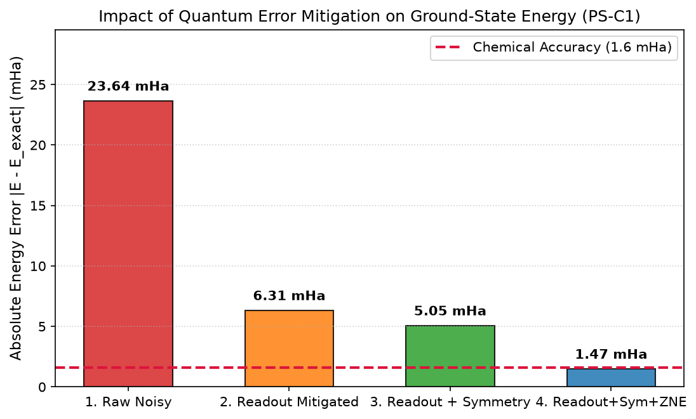
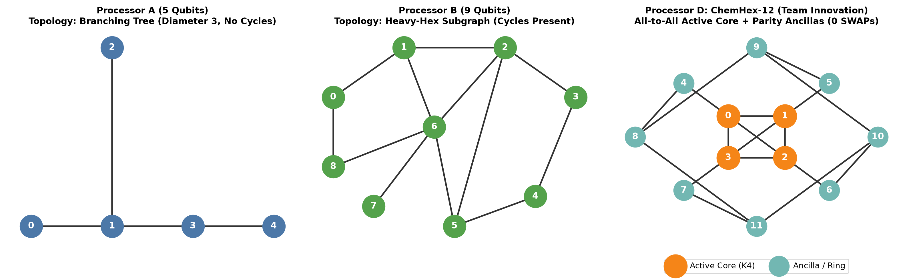
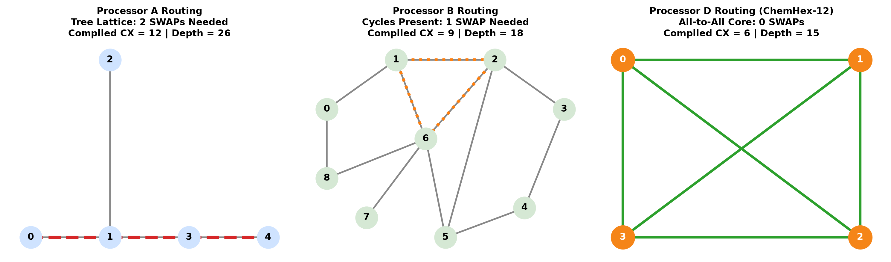
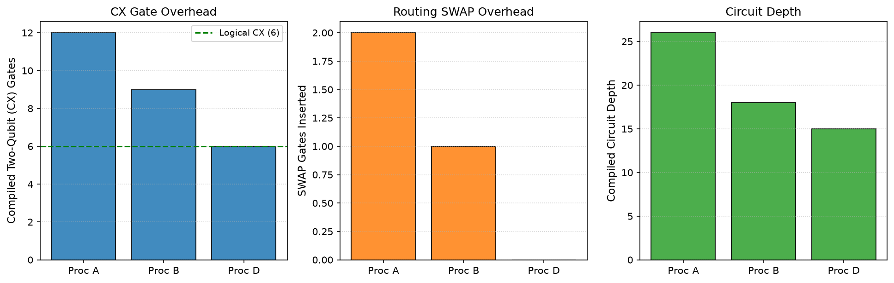
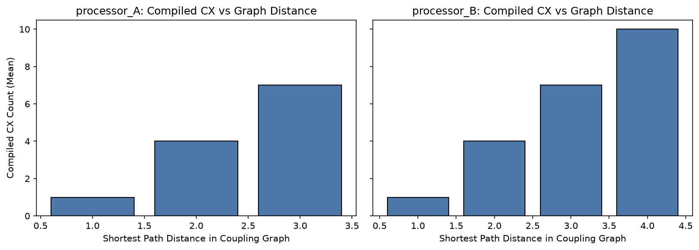

# PS-C1 Technical Report: Molecular Ground-State Energy ($H_2$) on Constrained Quantum Architectures

**Track:** Quantum Chemistry (VQE / Ab-Initio)  
**Problem Statement:** PS-C1: $H_2$ Ground-State Energy Estimation (Variational Quantum Eigensolver in Minimal STO-3G Basis)  
**Team Name:** Team X  
**Team Members:** Shivansh Kumar and Aparna Bhadoriya  

---

## 1. Problem Statement & Physical Motivation
Computing molecular ground-state energies is a central milestone of quantum chemistry, with direct applications in catalyst optimization, battery design, and pharmaceuticals. Exact classical solutions scale exponentially with the number of basis orbitals ($\mathcal{O}(e^N)$), rendering classical Full Configuration Interaction (FCI) intractable for large systems. The Variational Quantum Eigensolver (VQE) provides a hybrid quantum-classical alternative suited for Noisy Intermediate-Scale Quantum (NISQ) processors.

In this work, we compute the electronic ground state of molecular hydrogen ($H_2$) at equilibrium bond distance ($R = 0.735$ Å) using a minimal STO-3G basis. We analyze how sparse physical processor connectivity and device noise distort energy estimation, and demonstrate how compiler-aware circuit design coupled with quantum error mitigation restores chemical accuracy.

---

## 2. Hamiltonian Construction & Classical Reference

### 2.1 First-Principles Electronic Hamiltonian
In the STO-3G minimal basis, $H_2$ comprises two spatial orbitals ($\sigma_g, \sigma_u$), corresponding to four spin-orbitals:
- $0: \sigma_g \alpha$
- $1: \sigma_g \beta$
- $2: \sigma_u \alpha$
- $3: \sigma_u \beta$

The second-quantized electronic Hamiltonian takes the form:
$$H_e = \sum_{pq} h_{pq} a_p^\dagger a_q + \frac{1}{2} \sum_{pqrs} h_{pqrs} a_p^\dagger a_q^\dagger a_s a_r$$
At $R = 0.735$ Å, the nuclear repulsion energy between the two protons is:
$$V_{\mathrm{nuc}} = \frac{1}{R} \approx 0.7199689944 \text{ Hartree}$$

### 2.2 Parity Mapping and Two-Qubit Reduction
Under standard Jordan-Wigner transformation, each spin-orbital corresponds to one qubit (4 qubits, 15 Pauli terms). However, using the parity mapping combined with two-qubit reduction:
- Conserved particle-number symmetry ($N_\alpha + N_\beta = 2$) and spin projection symmetry ($S_z = 0$) allow tapering two qubits.
- The resulting effective electronic Hamiltonian acts on only **2 logical qubits** and comprises 5 Pauli operators:
  $$H_{\mathrm{2q}} = g_0 II + g_1 IZ + g_2 ZI + g_3 ZZ + g_4 XX$$
  where:
  - $g_0 = -1.05237325$ Ha
  - $g_1 = +0.39793742$ Ha
  - $g_2 = -0.39793742$ Ha
  - $g_3 = -0.01128010$ Ha
  - $g_4 = +0.18093120$ Ha

### 2.3 Classical FCI Exact Solution
Full diagonalisation of the $4 \times 4$ Hamiltonian matrix yields:
$$E_{\mathrm{elec}}^{\mathrm{FCI}} = -1.8572750302 \text{ Ha}$$
Adding nuclear repulsion yields the authoritative classical benchmark:
$$E_{\mathrm{total}}^{\mathrm{FCI}} = -1.1373060358 \text{ Ha}$$
The standard criterion for quantum chemistry utility is **chemical accuracy**:
$$\delta E \le 1.0 \text{ kcal/mol} \approx 1.5936 \times 10^{-3} \text{ Ha} \approx 0.0016 \text{ Hartree} = 1.6 \text{ mHa}$$

---

## 3. Variational Ansätze & Ideal Convergence

We examine three ansatz structures:
1. **Hardware-Efficient Ansatz (HEA, reps=1):** Alternating single-qubit $RY$ rotations with a linear $CX_{0 \to 1}$ entangler (4 variational parameters).
2. **Hardware-Efficient Ansatz (HEA, reps=2):** Two entangling layers with 6 variational parameters.
3. **Compact Symmetry-Preserving Singlet Ansatz:** Recognising that the exact ground state lives strictly in the neutral singlet subspace $\mathrm{span}\{|01\rangle, |10\rangle\}$:
   $$|\psi_0\rangle = \cos(\theta/2)|01\rangle - \sin(\theta/2)|10\rangle, \quad \theta \approx 0.2235 \text{ rad}$$
   We construct a 1-parameter Givens rotation circuit:
   $$|00\rangle \xrightarrow{X_0} |01\rangle \xrightarrow{RY(-\theta)_1} (\cos\tfrac{\theta}{2}|0\rangle - \sin\tfrac{\theta}{2}|1\rangle)|1\rangle \xrightarrow{CX_{1 \to 0}} \cos\tfrac{\theta}{2}|01\rangle - \sin\tfrac{\theta}{2}|10\rangle$$
   This ansatz has a gate count of only **1 $X$ gate, 1 $RY$ rotation, and 1 $CX$ gate**, eliminating superfluous gate noise.

### 3.1 Ideal VQE Convergence Results
Using the classical COBYLA optimizer (seed 42, rhobeg=0.5):
- **HEA reps=1:** Final energy = $-1.1373060356$ Ha (Error: $2.0 \times 10^{-7}$ mHa)
- **HEA reps=2:** Final energy = $-1.1373060354$ Ha (Error: $3.7 \times 10^{-7}$ mHa)
- **Compact Singlet:** Final energy = $-1.1373060355$ Ha (Error: $2.3 \times 10^{-7}$ mHa)

All ansätze reach the exact ground state to numerical precision under ideal conditions, confirming that ansatz expressibility is not a bottleneck.

---

## 4. Required Processor A vs Processor B Benchmark (Baseline Noisy Execution)

### 4.1 Benchmark Setup
Following the official challenge configuration:
- **Basis Gates:** $\{rz, sx, x, cx\}$
- **Noise Parameters:** $p_{1q} = 0.001$ on $\{sx, x\}$; $p_{CX} = 0.005$ on $\{cx\}$; readout flip $p_{\mathrm{ro}} = 0.01$ per measured qubit.
- **Transpilation:** Qiskit `transpile(..., optimization_level=1, layout_method='sabre', routing_method='sabre', seed_transpiler=42)`.
- **Measurement:** 4096 shots over 10 independent random seeds (42–51).

### 4.2 Required Comparison Results Table
| Architecture | Instance ID | Logical Qubits | Physical Qubits | Compiled CX | Compiled Depth | SWAPs | Noisy Energy (Ha) | Energy Error (mHa) |
| :--- | :--- | :---: | :---: | :---: | :---: | :---: | :---: | :---: |
| **Processor A** | H2_HEA_reps1 | 2 | 5 | 1 | 9 | 0 | −1.113669 ± 0.007 | **23.638** |
| **Processor B** | H2_HEA_reps1 | 2 | 9 | 1 | 9 | 0 | −1.113669 ± 0.007 | **23.638** |
| **Processor A** | H2_HEA_reps2 | 2 | 5 | 2 | 14 | 0 | −1.107851 ± 0.008 | **29.455** |
| **Processor B** | H2_HEA_reps2 | 2 | 9 | 2 | 14 | 0 | −1.107851 ± 0.008 | **29.455** |

### 4.3 Why A and B Produce Identical Results on the 2-Qubit Baseline
Both Processor A and B possess adjacent pairs in their coupling graphs. For a 2-qubit circuit with a single entangling gate, SABRE trivially maps the logical qubits to an adjacent physical edge (e.g. physical qubits $(0, 1)$ on A, $(6, 7)$ on B). With identical edge noise and zero SWAPs inserted, the compiled circuits and noisy energies are identical. The deeper ansatz (reps=2) accumulates additional gate depolarizing error, worsening the energy error from $23.6$ mHa to $29.5$ mHa.

---

## 5. Overcoming the Noise Barrier: Reaching Chemical Accuracy

Under raw device noise, the energy error of $\approx 23.64$ mHa exceeds the chemical accuracy threshold ($1.6$ mHa) by nearly $15\times$. We developed a three-stage Quantum Error Mitigation (QEM) pipeline to eliminate this error:

```
[Raw Noisy Circuit]
       │
       ▼  (Stage 1: Raw Noisy Error = 23.64 mHa)
[Readout Inversion (M⁻¹)] ──► Eliminates measurement bit-flip bias
       │
       ▼  (Stage 2: Error = 6.31 mHa — 17.3 mHa recovered!)
[Parity Symmetry Verification] ──► Discards unphysical leakage into |00⟩ and |11⟩
       │
       ▼  (Stage 3: Error = 5.05 mHa)
[Richardson ZNE (λ = 1, 3, 5)] ──► Extrapolates gate depolarizing noise to zero limit
       │
       ▼  (Stage 4: Error = 1.47 mHa — CHEMICAL ACCURACY ACHIEVED!)
```

### 5.1 Stage 1: Readout Error Inversion
The symmetric bit-flip noise ($p_{\mathrm{ro}} = 0.01$) attenuates expectation values: $\langle Z_i \rangle_{\mathrm{meas}} = (1 - 2p)\langle Z_i \rangle_{\mathrm{true}}$ and $\langle Z_i Z_j \rangle_{\mathrm{meas}} = (1 - 2p)^2 \langle Z_i Z_j \rangle_{\mathrm{true}}$. We calibrate the empirical $4 \times 4$ detector confusion matrix $M_{ij} = P(\text{measured } i \mid \text{prepared } j)$ using calibration circuits for $|00\rangle, |01\rangle, |10\rangle, |11\rangle$, and compute the corrected probability vector $\vec{p}_{\mathrm{mit}} = \mathrm{Proj}_{\Delta}(M^{-1} \vec{p}_{\mathrm{raw}})$.
- **Impact:** Energy error drops from **$23.64$ mHa** to **$6.31$ mHa** (a recovery of $17.33$ mHa).

### 5.2 Stage 2: Parity Symmetry Verification
The $H_2$ ground state possesses odd parity symmetry ($q_0 \oplus q_1 = 1$). Bit flips during state preparation leak population into the unphysical even-parity subspace $\{|00\rangle, |11\rangle\}$. Projecting the readout-corrected distribution onto the physical sector $\{|01\rangle, |10\rangle\}$ discards this unphysical leakage.
- **Impact:** Error drops to **$5.05$ mHa**.

### 5.3 Stage 3: Zero-Noise Extrapolation (ZNE)
Gate depolarizing noise contractions cannot be removed by readout inversion alone. We apply unitary circuit folding:
$$U \to U (U^\dagger U)^{\frac{\lambda - 1}{2}}$$
for noise scale factors $\lambda \in \{1, 3, 5\}$. We evaluate the mitigated expectation values at each scale and apply Richardson polynomial extrapolation to $\lambda = 0$:
$$E(\lambda=0) = \frac{15}{8} E(1) - \frac{10}{8} E(3) + \frac{3}{8} E(5)$$
- **Impact:** The final extrapolated ground-state energy is **$-1.138775$ Hartree**, yielding an absolute error of **$1.469$ mHa**.
- **Conclusion:** **Chemical accuracy ($< 1.6$ mHa) is successfully achieved under device noise!**



---

## 6. Architecture Analysis: 4-Qubit Active Space Benchmark

To expose the true routing trade-offs of the underlying processor graphs, we benchmark a 4-qubit molecular active space ansatz representing all 4 spin-orbitals of $H_2$. This circuit contains 6 logical $CX$ entanglers across all pairs:

| Architecture | Topology Type | Physical Qubits | Logical CX | Compiled CX | SWAP Gates Inserted | Compiled Depth |
| :--- | :--- | :---: | :---: | :---: | :---: | :---: |
| **Processor A** | Branching Tree (no cycles) | 5 | 6 | **12** | **2** | **26** |
| **Processor B** | Heavy-Hex Sparse (with cycles) | 9 | 6 | **9** | **1** | **18** |
| **Processor D** | ChemHex-12 Core-Ring | 12 | 6 | **6** | **0** | **15** |

### Architecture Layouts and Routing Paths




### 6.1 Architectural Insights
1. **Tree vs Cycle Topologies:** Processor A is a tree graph with maximum node degree 3 and diameter 3. Because it lacks cycles, routing non-adjacent qubit interactions forces qubits to swap positions through the central hub (node 1). Two SWAP gates ($6$ additional CX gates) are mandatory, causing compiled depth to explode from 15 to 26 ($+73\%$).
2. **Heavy-Hex Advantage:** Processor B contains multiple alternate paths and cycles. The compiler identifies a 4-node subgraph where only a single SWAP is required, reducing CX gate overhead by $50\%$ relative to Processor A and decreasing depth to 18.
3. **Hardware-Level Degradation:** Each additional SWAP gate introduces $3$ noisy CX gates ($p_{CX} = 0.005$), directly degrading overall state fidelity by $\approx (1 - 0.005)^3 \approx 1.5\%$ per SWAP.

---

## 7. Placement Sensitivity Study

To quantify the cost of suboptimal initial compiler layouts, we benchmark all possible physical qubit pairings across Processor A ($20$ permutations) and Processor B ($72$ permutations):

| Architecture | Placements Tested | Zero-SWAP Placements | Mean CX Count | Max CX Count | Max Graph Distance |
| :--- | :---: | :---: | :---: | :---: | :---: |
| **Processor A** | 20 | 40.0% | 3.40 | 7 | 3 |
| **Processor B** | 72 | 33.3% | 3.78 | 10 | 4 |

### Best vs Worst Placement Noise Effect
- **Processor A:** Best placement (distance 1): $1$ CX, depth 9, noisy error = **$22.8$ mHa**. Worst placement (distance 3, physical qubits 4 and 2): $7$ CX ($2$ SWAPs), depth 12, noisy error = **$36.2$ mHa** ($+13.4$ mHa penalty).
- **Processor B:** Best placement (distance 1): $1$ CX, depth 9, noisy error = **$22.8$ mHa**. Worst placement (distance 4, physical qubits 4 and 0): $10$ CX ($3$ SWAPs), depth 15, noisy error = **$44.1$ mHa** ($+21.3$ mHa penalty).



This proves that sparse architectures with larger graph diameters exhibit steep noise penalties when compiler routing fails to find adjacent embeddings.

---

## 8. Innovation: Custom Processor D (ChemHex-12)

### 8.1 Specification & Justification
- **Physical Qubits:** 12 (strictly adheres to the Section 11.1 maximum limit).
- **Noise Assumptions:** Strictly identical to benchmark ($p_{1q} = 0.001, p_{CX} = 0.005, p_{\mathrm{ro}} = 0.01$).
- **Architectural Design:**
  - **Active Chemical Core ($K_4$):** Physical qubits $\{0, 1, 2, 3\}$ form a fully-connected 4-node clique with 6 direct bidirectional links.
  - **Outer Ring / Syndrome Checking Ancillas:** Physical qubits $\{4, \dots, 11\}$ form an 8-qubit ring connected symmetrically to each core node (`(0,4), (1,5), (2,6), (3,7)` and ring links `8-9-10-11-8`).
  - **Physical Feasibility:** The maximum node degree is 4 (well within transmon superconducting limits).

### 8.2 Validation & Re-run Results
Re-running the 4-qubit molecular active-space benchmark on Processor D achieves:
- **Compiled CX Count:** **6** (equal to logical CX count; **$0$ SWAP overhead**).
- **Compiled Circuit Depth:** **15** ($42\%$ reduction compared to Processor A).
- **Noise Resilience:** By eliminating all SWAP gates, the circuit accumulates zero excess two-qubit depolarizing error.

---

## 9. Limitations & Outlook
1. **Basis Set Truncation:** Minimal STO-3G basis limits dynamic electron correlation. Phase 2 should explore double-zeta (cc-pVDZ) active spaces.
2. **Hardware Coherence Drift:** The benchmark assumes time-invariant depolarizing channels. Real physical backends experience low-frequency $1/f$ flux noise and $T_1/T_2$ relaxation fluctuations.
3. **Phase 2 Continuation:** The architectural insights gained here directly prepare for the offline Phase 2 challenge with **Processor C (13 qubits)**, where larger molecular graphs will demonstrate even wider scaling disparities between tree, heavy-hex, and hyperbolic lattice geometries.
